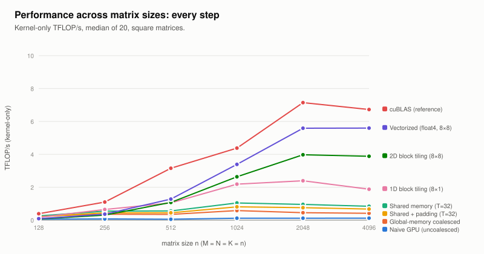
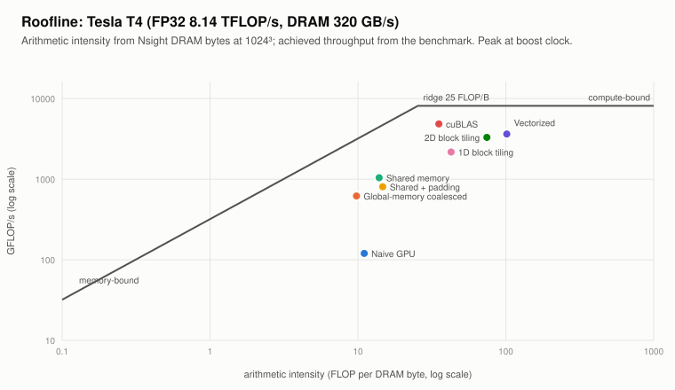

# The optimization journey: from a CPU loop to vectorized CUDA on a Tesla T4

A step-by-step optimization log. Each step has the same parts:
- **Concept:** the idea, and what changes from the previous step.
- **Code:** where it is in `src/matmul.cu`.
- **Prediction:** worked out before measuring.
- **Results:** a 4096³ table that grows by one row per step, and a graph across matrix sizes.
- **Nsight Compute:** what the profiler says.
- **Analysis:** why, and what to try next.

**Data.** Every number on this page comes from **one run** of `notebooks/colab_reproduce.ipynb` from a clean
clone (Tesla T4, CUDA 13.0, 13 Nov 2026, evening session). **399/399 correctness checks pass**
(`results/tests.txt`).
- Benchmarks: kernel-only time, median of 20 after 3 warm-ups (`results/results.csv`).
- Size curves: median of 10 for n ≤ 2048 (`results/sweep.csv`); the 4096 points come from the benchmark.
- Profiles: 1024³, with Nsight Compute locking the clock to base (585 MHz), so profiled times are about
  2.6× benchmark times (`results/profile_summary.csv`, `results/profile/rules_summary.md`).

**The whole ladder at 4096³** (`results/ladder_4096.md`, `results/plots/ladder_4096.svg`):

| Step | Kernel | Time (ms) | TFLOPS | Bandwidth (GB/s) | vs cuBLAS | Speedup over naive | Speedup over previous |
|---|---|---|---|---|---|---|---|
| 2 | CPU, i-k-j | 26,470 | 0.005 | 0.008 | 0.1% | 0.043× | – |
| 3 | Naive GPU (uncoalesced) | 1143 | 0.12 | 0.18 | 1.8% | 1.0× | – |
| 4 | Global-memory coalesced | 329.9 | 0.42 | 0.61 | 6.2% | 3.5× | **3.46×** |
| 5 | Shared memory (T=32) | 163.5 | 0.84 | 1.23 | 12.5% | 7.0× | **2.02×** |
| 5b | Shared + padding (T=32) | 204.5 | 0.67 | 0.99 | 10.0% | 5.6× | 0.80× (vs 5) |
| 6 | 1D block tiling (8×1) | 73.15 | 1.88 | 2.75 | 27.9% | 15.6× | **2.24×** |
| 7 | 2D block tiling (8×8) | 35.40 | 3.88 | 5.69 | 57.7% | 32.3× | **2.07×** |
| 8 | Vectorized (float4, 8×8) | 24.56 | **5.60** | 8.20 | **83.2%** | **46.5×** | **1.44×** |
| – | cuBLAS (reference) | 20.44 | 6.72 | 9.85 | 100% | 55.9× | – |

Bandwidth = (A + B + C bytes) / time: the minimum data the problem touches ("effective" bandwidth), as in
the reference post.



---

## 1. Hardware specifications

Measured on the run machine by `./devinfo` (`src/devinfo.cu`) and `scripts/hw_specs.py`
(`results/hw_specs.md`):

| Specification | Tesla T4 |
|---|---|
| Architecture / compute capability | Turing, sm_75 |
| SMs / FP32 cores | 40 × 64 = 2,560 |
| Max SM clock (boost) | 1590 MHz |
| **FP32 peak** = 40 × 64 × 2 × 1.59 GHz | **8.14 TFLOP/s** |
| Memory | 14.6 GiB GDDR6, 256-bit bus, 5001 MHz |
| **DRAM bandwidth** = 5001 MHz × 2 × 256 / 8 | **320 GB/s** |
| **Ridge point** = peak ÷ bandwidth | **25.4 FLOP/byte** |
| L2 cache | 4 MiB |
| Shared memory per SM / per block | 64 KiB / 48 KiB (64 KiB opt-in) |
| Registers per SM / per block | 65,536 / 65,536 (32-bit) |
| Max threads per SM / per block | 1024 / 1024 → **32 warps per SM** |
| Max resident blocks per SM | 16 |
| Power limit | 70 W |

**What it means for GEMM.**
- At 4096³ a matmul does 137 GFLOP on 201 MB of unique data: about 680 FLOP/byte if each byte were read
  once, far above the 25.4 FLOP/byte ridge. So a good GEMM is **compute-bound**, and each step below is a
  question of how far we are from that.
- The T4 holds only **32 warps per SM**: a 1024-thread block, or 64 registers per thread, already fills
  it. Registers decide occupancy for steps 6–8.



The **roofline** places each kernel at (FLOP per DRAM byte from Nsight, achieved GFLOP/s at 1024³):
- **The naive and shared-memory kernels sit left of the ridge** (≈ 10–15 FLOP/byte), in the memory-bound
  region. But they're far *below* the 320 GB/s memory roof: DRAM is only ~10% busy. They're limited by
  on-chip traffic (request count, shared memory), not DRAM bandwidth.
- **From 1D tiling on, the points move right of the ridge** (≈ 40–100 FLOP/byte) and up towards the
  8.14 TFLOP/s compute roof.

---

## 2. CPU baseline: loop order and locality

**Concept** (`cpu_matmul_ijk` at `src/matmul.cu:169`, `cpu_matmul` at `:154`):

| | i-j-k (`--impl cpu_ijk`) | i-k-j (`--impl cpu`, the baseline) |
|---|---|---|
| Inner loop walks | a row of A and **a column of B** (stride N) | **a row of B and a row of C** (stride 1) |
| Cache-line use on B | 4 of 64 bytes per miss | 64 of 64 bytes |
| SIMD | no (strided) | yes (contiguous) |

**Results** (`results/plots/sweep_cpu.svg`):

| n | i-j-k | i-k-j | i-k-j speedup |
|---|---|---|---|
| 128 | 1.63 GFLOP/s | 11.06 GFLOP/s | **6.8×** |
| 256 | 1.43 | 10.93 | **7.6×** |
| 512 | 1.12 | 5.24 | 4.7× |
| 4096 | – (too slow) | 5.19 (26.5 s) | |

**Analysis.**
- **Same arithmetic, 5–8× apart, purely from memory order.** i-j-k pays a cache miss per multiply-add on B
  and can't vectorize.
- **i-k-j itself halves from 256 to 512.** At n = 512, B is 1 MiB and no longer fits in the fast caches,
  so every row of C re-streams B. At 4096 that's 64 MiB per row, from DRAM.
- The fix would be cache blocking, the CPU equivalent of GPU tiling; the baseline deliberately stays three
  plain loops.

---

## 3. Naive GPU: one thread per output, uncoalesced

**Concept** (`matmul_naive_uncoal`, `src/matmul.cu:198`). One thread per C[row][col], full length-K dot
product from global memory. As in the reference post's first kernel, **`threadIdx.x` → row**:

```cpp
int row = blockIdx.x * blockDim.x + threadIdx.x;   // neighbouring threads -> neighbouring ROWS
int col = blockIdx.y * blockDim.y + threadIdx.y;
```

**Prediction.** A half-warp's 16 threads read `A[row*K + k]` at addresses **K floats apart**, one 32-byte
sector each for 4 useful bytes (12.5%). C is written N floats apart.

**Results:** 1143 ms at 4096³, **0.12 TFLOPS**, flat at 0.06–0.12 TFLOP/s across all sizes
(`results/plots/sweep_1_naive_uncoal.svg`). Still **23×** faster than the CPU at 4096³.

**Nsight** (1024³):
- Global load efficiency **13.2%** (predicted 12.5%): **"only 4.2 of the 32 bytes transmitted per sector
  are utilized"**, and 71% of sectors are excess.
- Stores: 8 of 32 bytes per sector.
- **187.6 of 194.5 cycles (96%)** between instructions are spent stalled on the global-memory (LG) queue.
  IPC 0.16, SM throughput 11.7%.

**Analysis.** A million threads already beat the CPU, but almost every memory transaction is mostly
wasted, and warps do nothing but wait for it.

---

## 4. Global-memory coalescing

**Concept** (`matmul_naive`, `src/matmul.cu:182`, the project's required naive version). Swap the
mapping so **`threadIdx.x` → column**:

```cpp
int col = blockIdx.x * blockDim.x + threadIdx.x;   // neighbouring threads -> neighbouring COLUMNS
int row = blockIdx.y * blockDim.y + threadIdx.y;
```

A warp now reads 16 consecutive floats of a B row (2 full sectors) and broadcasts one A value per thread
row. Predicted load efficiency: (64 + 8)/(64 + 64) = **56.25%**.

**Results:** 329.9 ms, **3.46× faster** than uncoalesced at 4096³ (5.5× at 1024³ under the profiler).

**Nsight** (1024³):
- Load efficiency **56.25%**, exactly as predicted.
- Warps now stall 28.9 of 35.6 cycles (81%) on the LG queue, versus 96% before.
- **The same 67.1 M load requests**: coalescing makes each request cheaper but doesn't reduce their
  number. Each input element is still read 1024 times (8.6 GB of reads for 8 MB of data).
- DRAM 7.6% busy: the L2 cache absorbs the repeats.

**Analysis.** The limit is now the sheer number of global load requests.

---

## 5. Shared-memory caching

**Concept** (`matmul_tiled<32,0,false>`, `src/matmul.cu:210`; `docs/figures/tiling.svg`).
- A 32×32 block owns a 32×32 tile of C.
- It cooperatively loads one 32×32 tile of A and one of B into shared memory per K step.
- Then `__syncthreads()`, 32 multiply-adds per thread from shared memory, `__syncthreads()` again.
- Zero-fill and a guarded store handle any size.

**Prediction.** Load requests fall exactly 32×. Shared reads are row-wise or broadcast, so 0 conflicts.

**Results:** 163.5 ms, **2.02×** over coalesced at 4096³ (`results/plots/sweep_3_tiled.svg`).

**Nsight** (1024³):
- Requests **67.1 M → 2.10 M** (exactly 32×); load efficiency 100%; **0 bank conflicts**.
- **Occupancy 100%.** Unlike the reference post's RTX 4090 (48 warps per SM, so 66.7% there), one
  1024-thread block fills the T4's 32 warps.
- New limiter: **24.0 of 36.8 cycles (65%) stalled on the MIO (shared-memory) queue**.
- Shared loads are **39.6% of all instructions** (the post's "LDS dominates the instruction mix").

**Analysis.** Each multiply-add needs two shared-memory reads, so the kernel can only go as fast as shared
memory feeds it. Across every tiled variant, kernel time tracks shared-memory wavefronts at about 100 ns
per million (`results/plots/time_vs_wavefronts.svg`).

### 5b. Shared memory with padding (project requirement)

**Concept.** The same kernel with `As[32][33]`, `Bs[32][33]`. Padding fixes **column** access to shared
memory (`docs/figures/banks.svg`).

**Prediction** (`scripts/bank_model.py`): tiled has no column access, so padding can only cost. Rows of 33
floats aren't 16-byte aligned, so nvcc loses its 128-bit `LDS.128` reads.

**Results:** 204.5 ms, **20% slower** than tiled at 4096³; slower on every shape and size
(`results/plots/padding_effect.svg`).

**Nsight:**
- Shared loads go from 39.6% to **51.1%** of instructions.
- Instruction count rises from 106 M to **131 M**.
- 0 conflicts at T = 32 and 4.19 M new store conflicts at T = 16, as predicted.
- When A is deliberately stored transposed (`tiled_ta`, a column write), padding takes store conflicts
  from **32.5 M to 0** (`padded_ta`).

**Lesson:** padding is a fix for column access, not a general speedup. If you use vector loads, pad by 4,
not 1 (steps 6–8 do).

---

## 6. 1D block tiling

**Concept** (`matmul_tile1d`, `src/matmul.cu:325`).
- Each thread computes **8 outputs down one column**; 512-thread blocks own a 64×64 tile; K step 8.
- Per k, one B value is loaded into a register and reused for 8 multiply-adds.

```cpp
for (int k = 0; k < 8; k++) {
    const float b = Bs[k * 64 + tc];                                     // one load, kept in a register
    for (int i = 0; i < 8; i++) acc[i] += As[(tr * 8 + i) * 8 + k] * b;  // reused 8 times
}
```

**Prediction.**
- Shared reads per FMA fall from 2 to about 1.1.
- `As` reads are a warp-wide broadcast and `Bs` reads are consecutive, so 0 conflicts.
- Global reuse doubles (64-wide tile).

**Results:** 73.15 ms, **2.24×** over shared memory at 4096³ (the post saw 3.0× on an RTX 4090). At small
sizes it beats the big-tile kernels 7 and 8: 0.65 vs 0.31 TFLOP/s at n = 256
(`results/plots/sweep_5_tile1d.svg`).

**Nsight** (1024³):
- Shared loads fall from **39.6% to 19.2%** of instructions; total instructions 106 M → 66 M.
- Wavefronts 52.4 M → 22.0 M; **0 conflicts**.
- MIO stalls fall from 24.0 to 13.0 cycles.
- 64 registers per thread, 2 blocks per SM, occupancy 94%.
- nvcc packs the `As` reads into `LDS.128` (16 per tile).
- Nsight also flags "local loads/stores, 1 of 32 bytes". The SASS shows a single local store/load pair
  before the main loop, which is negligible, so that rule's 85% estimate doesn't apply here.

**Analysis.** Reuse in one direction halved the shared-memory traffic. B is reused 8×, but each A value
is still used once per load.

---

## 7. 2D block tiling

**Concept** (`matmul_tile2d`, `src/matmul.cu:373`; `docs/figures/regtile.svg`).
- Each thread computes an **8×8 block**: per k, 8 A values and 8 B values go into registers, then 64
  multiply-adds (an outer product). That's 0.25 shared loads per FMA.
- 256-thread blocks own a 128×128 tile.
- Kept **plain on purpose**, like the reference post's kernel: scalar global loads, A tile row-major, each
  thread owning **8 adjacent columns**.

**Prediction** (bank model): A reads are 2-way conflicts and B reads 4-way; despite that, a clear gain from
4× more arithmetic per load.

**Results:** 35.40 ms, **2.07×** over 1D at 4096³, 57.7% of cuBLAS. **But it's the slowest tiled kernel at
small sizes** (0.07 TFLOP/s at n = 128, 0.31 at 256): a 128×128 tile gives only 1–4 blocks for 40 SMs
(`results/plots/sweep_6_tile2d.svg`).

**Nsight** (1024³):
- **"5.0-way bank conflict across all shared load requests"**, 4.19 M conflicts, 40% of shared-load
  wavefronts. That's the same finding as the reference post's 5.6-way.
- nvcc already turned the reads into `LDS.U.128`, so the conflicts come from the layout, not the load
  width.
- **129 registers per thread** limits occupancy to **25%** (8 warps per SM); Nsight estimates 57% from
  that.
- Only 64 blocks at 1024³ (1.6 waves).
- C stores: 4 of 32 bytes per sector (each thread writes 8 adjacent floats with scalar stores).
- Yet warps wait only **5.8 cycles** between instructions (vs 25.1 for 1D): 64 independent FMAs per step
  hide the latency.

**Analysis.** The outer product removed the shared-memory bottleneck almost completely: shared loads are
4.9% of instructions. What's left is the conflicting layout, the register-limited occupancy, uncoalesced
stores and too few blocks.

---

## 8. Vectorized memory access

**Concept** (`matmul_vec<128,128,8,8,8>` = `--impl vec128`, `src/matmul.cu:432`). The same 8×8 tiling as
step 7, plus:
- **`float4` (128-bit) global loads** of A and B (`LDG.E.128`) and **`float4` C stores**;
- **A stored transposed** so a thread's 8 A values are contiguous, with the row **padded by 4**:
  conflict-free *and* 16-byte aligned;
- each thread's 8 columns split into **two groups of 4, 64 apart**, so neighbouring threads read
  neighbouring 16-byte chunks: conflict-free.

`float4` needs 16-byte alignment, so it's used only when K (for A) or N (for B and C) is a multiple of 4
and all 4 elements are in range. Otherwise there's a scalar fallback, so any size stays correct.

**Results:** 24.56 ms, **5.60 TFLOPS = 83.2% of cuBLAS**, **1.44×** over plain 2D tiling, **46.5×** over
the uncoalesced naive (`results/plots/sweep_7_vec128.svg`).

**Nsight** (1024³):
- **0 bank conflicts** (vs 4.19 M for step 7); global load requests 0.52 M → 0.13 M.
- **123 registers**, so 50% theoretical occupancy (twice step 7's, because the layout needs fewer
  registers).
- **The FMA pipe is the busiest unit (61%)**: the first kernel that is mainly compute-limited.

**Analysis.**
- **Vectorization alone** (`vec` vs `regtile`, same 4×4 tiling) gives only **1.05× at 4096³**: regtile's
  shared reads were already 128-bit, and global memory wasn't its bottleneck.
- **The step-8 gain over step 7** comes from three things together: removing the bank conflicts, doubling
  occupancy, and coalesced 128-bit stores.
- **On odd sizes** (1000×513×769) the scalar fallback is uncoalesced (19.5% load efficiency), and vec128 is
  only 1.47× over tile2d there.

---

## 9. Summary

| Step | Change | Bottleneck removed | New bottleneck (Nsight, 1024³) | Speedup |
|---|---|---|---|---|
| 2 → 3 | CPU → one thread per output | serial execution | uncoalesced loads: 96% LG stalls, 4.2/32 B per sector | 23× |
| 3 → 4 | `threadIdx.x` → column | wasted sectors | redundant requests: 67 M, 81% LG stalls | 3.46× |
| 4 → 5 | shared-memory tiles | redundant requests (32× fewer) | shared-memory pipe: 65% MIO stalls | 2.02× |
| 5 → 5b | padding `[T][T+1]` | nothing (no conflicts existed) | lost 128-bit loads, +24% instructions | 0.80× |
| 5 → 6 | 8 outputs per thread (1D) | half the shared traffic | MIO stalls 13 cycles, latency | 2.24× |
| 6 → 7 | 8×8 per thread (2D) | shared traffic (4.9% of instr.) | 5-way conflicts, 25% occupancy, few blocks | 2.07× |
| 7 → 8 | float4 + conflict-free layout | conflicts, half the registers | FMA 61%, 0.8 waves | 1.44× |
| – | cuBLAS | – | FMA 89% (compute-bound) | 1.20× ahead |

**Across sizes:**
- Most steps gain more as n grows (the uncoalesced naive stays flat).
- The big-tile kernels (7, 8) lose at n ≤ 256, where 128×128 tiles leave most SMs idle. There the
  64-wide-tile kernels (regtile, then 1D tiling) are fastest, and cuBLAS is still about 1.3–2× faster.
- A single "best" kernel doesn't exist; libraries choose per shape.
