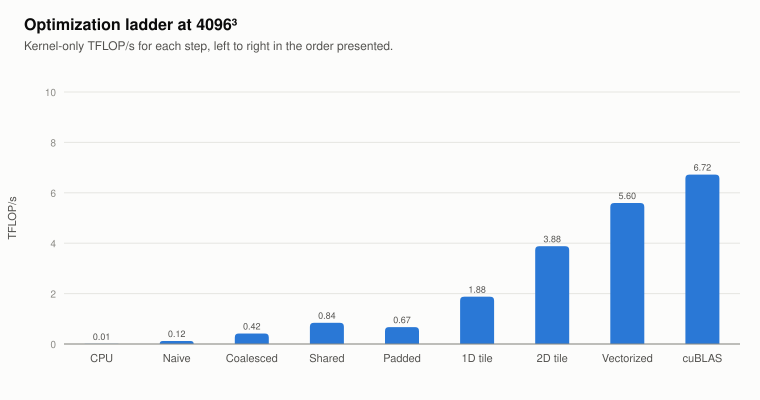
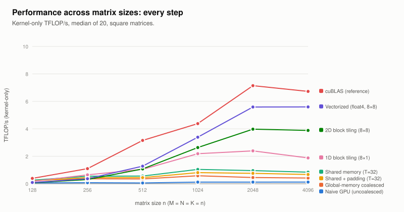

# Matrix Multiplication from CPU to Optimized CUDA: Final Report

**Course project, GPU Programming, IIT Madras · Tesla T4 · November 2026**

All numbers come from **one complete run** of `scripts/reproduce.sh`, launched from a clean clone with
`notebooks/colab_reproduce.ipynb` (13 Nov 2026, evening session). The one exception is the 6th shape, run in
an earlier session and marked as such in §6. Raw data is in `results/`. A step-by-step version of this
report, in the style of a GEMM optimization log, is [optimization_journey.md](optimization_journey.md).

---

## 1. Problem, environment and methodology

We compute **C = A·B** for row-major FP32 matrices A (M×K) and B (K×N), with any 1 ≤ M, N, K ≤ 16384.
There are four required implementations: single-threaded CPU, naive CUDA, shared-memory tiled CUDA, and
tiled with shared-memory padding. Beyond that:
- an optimization ladder (uncoalesced naive, 1D and 2D register tiling, vectorized access);
- **cuBLAS SGEMM**, used only as an external reference.

Everything is one program:
`./matmul --impl {cpu,naive,tiled,padded,…} --input IN.bin --output OUT.bin [--tile 8|16|32]`.

| | |
|---|---|
| GPU | NVIDIA Tesla T4: Turing, sm_75, 40 SMs × 64 FP32 cores, max SM clock 1590 MHz, 70 W, driver 580.82.07 |
| Peaks (`results/hw_specs.md`) | FP32 **8.14 TFLOP/s**, DRAM **320 GB/s**, ridge point **25.4 FLOP/byte**; 32 warps, 64 KiB shared memory and 64 K registers per SM |
| CPU | Intel Xeon @ 2.00 GHz, 2 vCPUs (Google Colab VM) |
| Toolchain | CUDA 13.0 (`nvcc` V13.0.88), host g++ |
| Flags | `nvcc -O3 -std=c++14 -arch=native -lineinfo -lcublas`; `g++ -O2` for `compare` |
| Clocks | Not lockable on Colab: GPU boost clock and power management left at defaults. Nsight Compute locks the SM clock to base (585 MHz) while profiling, so profiled times are ~2.6× benchmark times |
| Tile size | `--tile 32` by default (fastest, §4); ladder kernels use fixed 64×64 or 128×128 block tiles |
| Inputs | `scripts/gen.py M K N 42`: values uniform in [−1, 1], fixed seed, binary format per spec |

**Timing.**
- **Kernel-only:** CUDA events around the launch.
- **End-to-end:** host `steady_clock` around `cudaMalloc` + host→device copies + kernel + device→host
  copy + `cudaFree`.
- **CPU:** `steady_clock` around the multiplication only.
- GPU: **median of 20 trials after 3 warm-ups**. CPU: median of 3 (1 for shapes above 2·10⁹ multiply-adds).
- Size curves (`scripts/sweep.sh`): median of 10.
- Context and cuBLAS-handle creation happen before timing.
- GFLOP/s = 2·M·N·K / time.
- Commands: `bash scripts/reproduce.sh`, which runs `bench.sh`, `sweep.sh`, `edge_sweep.sh` and
  `profile.sh`.

**Correctness criterion.** Every GPU output is compared element-wise with the CPU result:
`|out − ref| ≤ 1e-4·K + 1e-4·|ref|`, rejecting NaN and Inf (`src/compare.cpp`). The CPU result is itself
checked against a float64 NumPy product.

---

## 2. Implementations

### 2.1 Single-threaded CPU: loop order i-k-j

```
for i in 0..M-1:  for k in 0..K-1:  a = A[i][k];  for j in 0..N-1:  C[i][j] += a * B[k][j]
```

- The inner loop walks one row of B and one row of C with stride 1, and `A[i][k]` stays in a register.
  Every fetched cache line is fully used and the loop vectorizes.
- The textbook **i-j-k** order (`--impl cpu_ijk`) reads B down a column: measured **4.7–7.6× slower**
  (1.1–1.6 vs 5.2–11.1 GFLOP/s, n = 128–512).
- i-k-j drops from 11 to 5 GFLOP/s once B no longer fits in cache (n ≥ 512); at 4096³ it takes 26.5 s.

### 2.2 Naive CUDA: one thread per output element

```
block = (16, 16); grid = (ceil(N/16), ceil(M/16))
col = blockIdx.x*16 + threadIdx.x;  row = blockIdx.y*16 + threadIdx.y
if row < M and col < N:  C[row][col] = Σk A[row][k] * B[k][col]      # all operands from global memory
```

`threadIdx.x` maps to the **column**, so a warp reads neighbouring floats of a B row (coalesced) and writes
neighbouring C elements. Each output needs 2K global loads.


A 16×16 block puts two thread rows in one warp. The B load is two full sectors; the A load touches two
rows, so two sectors for 8 useful bytes. Predicted load efficiency (64 + 8)/(64 + 64) = **56.25%**, exactly
what Nsight measures.

To measure what coalescing buys, `naive_uncoal` swaps the mapping (`threadIdx.x` → row). Its load
efficiency is **13.2%**: "4.2 of 32 bytes per sector used". It's **2.6–5.2× slower**.

### 2.3 Shared-memory tiled CUDA (`matmul_tiled<T, 0, false>`, T ∈ {8, 16, 32})


```
__shared__ float As[T][T], Bs[T][T]
row = by*T + ty;  col = bx*T + tx;  acc = 0
for t in 0 .. ceil(K/T)-1:
    As[ty][tx] = (row<M && t*T+tx<K) ? A[row][t*T+tx] : 0        # cooperative, coalesced, zero-filled
    Bs[ty][tx] = (t*T+ty<K && col<N) ? B[t*T+ty][col] : 0
    __syncthreads()                                              # tile complete before anyone reads it
    for k in 0..T-1:  acc += As[ty][k] * Bs[k][tx]               # each loaded value used by T threads
    __syncthreads()                                              # all reads done before it is overwritten
if row<M && col<N:  C[row][col] = acc                            # guarded store, no early return
```

- **Cooperative loading:** global loads per output drop from 2K to 2K/T.
- **Two barriers:** the first guards against reading a half-loaded tile; the second against overwriting a
  tile still being read.
- **Edges:** out-of-range elements load as 0, and threads outside C still load and reach both barriers.
- **Tile size:** T is a template parameter. `check_tile_resources` rejects a T that doesn't fit the
  device, with a clear error.
- **Access:** `tx` → column gives 100% load efficiency. Shared accesses are along rows or broadcasts, so
  **0 bank conflicts**, and nvcc reads `As[ty][k..k+3]` with one 128-bit `LDS.U.128`.

### 2.4 Tiled with padding (`padded` = `matmul_tiled<T, 1, false>`)

Identical source with `__shared__ float As[T][T+1], Bs[T][T+1]`; padding is the only variable.


Padding fixes **column** access: with row length 32, a column sits in one bank; with 33,
bank = (r + c) mod 32. `tiled` never walks a column, so padding has nothing to fix, and it costs:
1. 33-float rows aren't 16-byte aligned, so `LDS.U.128` is lost: shared load instructions **41.9 M → 67.1 M**.
2. At T = 8 and 16 the odd row length creates **2-way store conflicts**.

Storing the A tile **transposed** (`As[tx][ty]`, a column write) shows the mechanism working:

| 1024³, T = 32 | tiled_ta (row 32) | padded_ta (row 33) |
|---|---|---|
| Store bank conflicts (Nsight) | **32,505,856** | **0** |
| Kernel time | 3.67 ms | 2.66 ms (**1.38× faster**) |

### 2.5 Register tiling and vectorized access


The tiled kernel is limited by shared memory: two shared loads per multiply-add. Register tiling makes each
thread compute several outputs, reusing each shared value from registers:

| `--impl` | Block tile | Per thread | Shared loads per FMA | Notes |
|---|---|---|---|---|
| `tile1d` | 64×64, 512 threads | 8×1 (a column) | ≈ 1.1 | one B value in a register, reused 8× |
| `tile2d` | 128×128, 256 threads | 8×8 outer product | 0.25 | plain: scalar global loads, 8 adjacent columns per thread |
| `regtile` | 64×64, 256 threads | 4×4 | 0.125 (128-bit) | A transposed, row padded by **4** (conflict-free and aligned) |
| `vec` | 64×64 | 4×4 | 0.125 | `regtile` + `float4` global loads and stores: isolates vectorization |
| `vec128` | 128×128, 256 threads | 8×8 | 0.0625 (128-bit) | `tile2d` tiling + `float4` everywhere + conflict-free layout |

```
# 2D register tiling (tile2d / vec128): each thread owns an 8x8 block of C in registers
for k0 in 0, 8, 16, ...:
    cooperative zero-filled load of A[128][8] and B[8][128] into shared memory;  __syncthreads()
    for k in 0..7:  a[0..7] = A column k;  b[0..7] = B row k;  acc[i][j] += a[i]*b[j]   (64 FMAs)
    __syncthreads()
guarded stores of the 8x8 block
```

`vec128` was adapted from a supplied kernel, with these changes:
- bounds checks with zero fill;
- `float4` only when K % 4 = 0 (A rows) or N % 4 = 0 (B, C rows) and all 4 elements are in range;
  scalar otherwise;
- no read of the uninitialized output (no β·C);
- a padded transposed A tile (the original had a 2-way conflict);
- each thread's 8 columns split into two groups of 4, half a tile apart (8 adjacent columns double the
  shared-memory passes).

---

## 3. Correctness

`scripts/run_tests.sh` checks every implementation and tile size on **18 shapes**:
- square, tall and wide;
- smaller than a block (5×3×7);
- divisible by 16 and 32;
- one below and above tile multiples (15×17×16, 31³, 33³, 7×9×9, 65×63×129);
- M, K or N = 1, and 1×1×1;
- **1000×513×769**;
- `float4` alignment mixes (130×132×260, 129×64×130).

It also checks that a bad `--impl`, a missing input file and an unsupported `--tile` exit with a nonzero
status.

**Result: 399 / 399 checks pass** (`results/tests.txt`).
- Worst absolute error for every GPU version is **1.14 × 10⁻⁵** (at 1000×513×769), about 4500× below the
  tolerance (≥ 0.051 at K = 513).
- The CPU matches float64 NumPy to 3.2 × 10⁻⁵, and `cpu_ijk` matches `cpu` exactly.
- The worst relative error (9.6%) is on an element whose reference is almost zero, which is why the
  tolerance has an absolute term.
- All GPU versions give the same worst error, consistent with each summing along k in the same order with
  fused multiply-adds.

---

## 4. Performance results

**Summary, 4096 × 4096 × 4096** (`results/ladder_4096.md`):

| Kernel | Time (ms) | TFLOPS | Bandwidth (GB/s) | vs cuBLAS | Speedup over naive (uncoalesced) |
|---|---|---|---|---|---|
| CPU (single thread, i-k-j) | 26,470 | 0.005 | 0.008 | 0.1% | 0.043× |
| Naive, uncoalesced | 1143 | 0.12 | 0.18 | 1.8% | 1.0× |
| **Naive, coalesced** (required) | 329.9 | 0.42 | 0.61 | 6.2% | 3.5× |
| **Shared-memory tiled** (T=32, required) | 163.5 | 0.84 | 1.23 | 12.5% | 7.0× |
| **Tiled + padding** (T=32, required) | 204.5 | 0.67 | 0.99 | 10.0% | 5.6× |
| 1D register tiling (8×1) | 73.15 | 1.88 | 2.75 | 27.9% | 15.6× |
| 2D register tiling (8×8) | 35.40 | 3.88 | 5.69 | 57.7% | 32.3× |
| 2D register tiling 4×4 (regtile) | 44.27 | 3.11 | 4.55 | 46.2% | 25.8× |
| + `float4` (vec, 4×4) | 42.26 | 3.25 | 4.76 | 48.4% | 27.0× |
| **Vectorized 8×8 (vec128)** | 24.56 | **5.60** | 8.20 | **83.2%** | **46.5×** |
| cuBLAS SGEMM (reference) | 20.44 | 6.72 | 9.85 | 100% | 55.9× |

Bandwidth = (A + B + C bytes) / kernel time ("effective" bandwidth, not measured DRAM traffic).



All shapes, kernel-only time in ms (GFLOP/s):

| Shape | CPU | naive | tiled | padded | tile1d | tile2d | regtile | vec | vec128 | cuBLAS | best / cuBLAS |
|---|---|---|---|---|---|---|---|---|---|---|---|
| 256³ | 3.37 | 0.079 (424) | 0.056 (603) | 0.072 (469) | 0.050 (675) | 0.107 (315) | **0.039 (869)** | 0.042 (793) | 0.087 (386) | 0.029 (1162) | 75% |
| 1024³ | 371 | 3.47 (620) | 2.06 (1044) | 2.67 (805) | 0.988 (2175) | 0.651 (3301) | 0.606 (3543) | 0.608 (3534) | **0.591 (3632)** | 0.442 (4858) | 75% |
| 4096³ | 26,470 | 330 (417) | 164 (841) | 204 (672) | 73.1 (1879) | 35.4 (3882) | 44.3 (3105) | 42.3 (3252) | **24.6 (5597)** | 20.4 (6723) | 83% |
| 2048×512×4096 | 872 | 17.3 (498) | 8.46 (1016) | 11.2 (769) | 3.65 (2356) | 2.31 (3723) | 2.22 (3868) | 2.17 (3955) | **1.46 (5866)** | 1.21 (7101) | 83% |
| 1000×513×769 | 95.1 | 1.02 (774) | 1.19 (665) | 1.90 (415) | 0.823 (959) | 0.538 (1466) | 0.422 (1871) | 0.506 (1560) | **0.367 (2148)** | 0.213 (3705) | 58% |

| Speedup (kernel-only) | 256³ | 1024³ | 4096³ | 2048×512×4096 | 1000×513×769 |
|---|---|---|---|---|---|
| naive vs CPU | 43× | 107× | 80× | 51× | 93× |
| best GPU kernel vs CPU | 87× | 627× | 1078× | 596× | 259× |
| uncoalesced → coalesced | 4.49× | 5.17× | 3.46× | 4.20× | 2.59× |
| coalesced → tiled | 1.42× | 1.69× | 2.02× | 2.04× | 0.86× |
| tiled → padded | 0.78× | 0.77× | 0.80× | 0.76× | 0.62× |
| tiled → 1D tiling | 1.12× | 2.08× | 2.24× | 2.32× | 1.44× |
| 1D → 2D tiling | 0.47× | 1.52× | 2.07× | 1.58× | 1.53× |
| 2D → vectorized | 1.23× | 1.10× | 1.44× | 1.58× | 1.47× |

Values below 1 are slowdowns. Plots in `results/plots/`:
- [every step across sizes](../results/plots/sweep_all.svg) and one chart per step (`sweep_<n>_<step>.svg`);
- [tile sizes](../results/plots/tile_sizes.svg), [padding](../results/plots/padding_effect.svg),
  [gap to cuBLAS](../results/plots/percent_of_cublas.svg).



**Tile size (tiled kernel, ms):**

| | 256³ | 1024³ | 4096³ | 2048×512×4096 | 1000×513×769 |
|---|---|---|---|---|---|
| T = 8 | 0.072 | 3.38 | 372 | 17.0 | 1.61 |
| T = 16 | 0.056 | 2.15 | 223 | 9.69 | **1.14** |
| T = 32 | **0.056** | **2.06** | **164** | **8.46** | 1.19 |

- T = 32 is fastest on four of five shapes (T = 16 by 4% on the irregular one), and it's the default.
- T = 8 is slower than naive at 4096³ and 1000×513×769: the same shared-load instruction count, but 4× the
  global requests and barriers.

**End-to-end** (ms, allocation + copies + kernel + copy back + free):

| | naive | tiled | tile2d | regtile | vec128 | cuBLAS |
|---|---|---|---|---|---|---|
| 1024³ | 7.33 | 6.19 | 4.43 | 4.12 | 4.09 | 4.03 |
| 4096³ | 381 | 213 | 85.7 | 98.2 | 75.5 | 72.4 |

Once the kernel is fast, PCIe transfers and allocation dominate: at 1024³ the vec128 kernel is 14% of its
end-to-end time ([kernel share](../results/plots/kernel_share_e2e.svg)).

---

## 5. Profiler evidence and the optimization log

Nsight Compute at 1024³, base clock (`results/profile_summary.csv`; every rule message is in
`results/profile/rules_summary.md`). A second shape, 1000×513×769, is profiled for every kernel too.

| | uncoal. | naive | tiled T=32 | padded | tile1d | tile2d | regtile | vec128 | cuBLAS |
|---|---|---|---|---|---|---|---|---|---|
| Time (ms, ncu) | 49.1 | 8.97 | 5.30 | 6.94 | 2.58 | 1.70 | 1.55 | 1.18 | 0.82 |
| Global load requests | 67.1 M | 67.1 M | 2.10 M | 2.10 M | 1.05 M | 0.52 M | 1.05 M | 0.13 M | 0.92 M |
| Global load efficiency | **13%** | 56% | 100% | 100% | 100% | 100% | 100% | 100% | 81% |
| Shared loads / all instructions | – | – | **40%** | 51% | 19% | 5% | 8% | 5% | 6% |
| Shared bank conflicts (ld / st) | – | – | 0 / 0 | 0 / 0 | 0 / 0 | **4.19 M** / 0 | 0 / 0 | 0 / 0 | 39 K / 258 K |
| Registers / thread | 50 | 50 | 44 | 36 | 64 | **129** | 64 | 123 | 122 |
| Theoretical / achieved occupancy | 100 / 98% | 100 / 99% | 100 / 100% | 100 / 100% | 100 / 94% | **25 / 25%** | 100 / 84% | 50 / 36% | 50 / 47% |
| Warp cycles per issued instruction | **194** | 35.6 | 36.8 | 38.9 | 25.1 | 5.8 | 17.4 | 6.6 | 6.8 |
| SM throughput | 12% | 64% | 74% | 88% | 54% | 43% | 48% | 61% | 89% |
| Main limiter (Nsight) | LG queue (96% of stalls) | LG queue (81%) | MIO, shared (65%) | MIO (67%) | MIO (52%), latency | conflicts, occupancy, 1.6 waves | latency, 1.6 waves | FMA 61%, 0.8 waves | **FMA 89%** |

**1. Coalescing (uncoalesced → naive, 2.6–5.2×).**
- Load efficiency 13% → 56.25% (both as predicted).
- Stalls on the global-memory queue fall from 187.6 to 28.9 cycles per instruction.
- The 67 M requests remain: each element is still read 1024 times.

**2. Shared-memory tiling (1.7–2.0× from 1024³ up).**
- Requests fall **exactly T×** (8.39 / 4.19 / 2.10 M for T = 8 / 16 / 32), and efficiency reaches 100%.
- DRAM traffic falls only 1.1–1.5×, because L2 was already absorbing the repeats.
- New limiter: **65% of cycles waiting on the shared-memory (MIO) queue**; shared loads are 40% of all
  instructions. Kernel time tracks shared-memory wavefronts at about 100 ns per million
  ([plot](../results/plots/time_vs_wavefronts.svg)).

**3. Padding (required; 20–38% slower).**
- `scripts/bank_model.py` predicted every bank-conflict count, and **Nsight matched it exactly**: 0 for
  tiled, 4,194,304 store conflicts for padded T = 16, 32,505,856 for tiled_ta T = 32.
- The lost `LDS.128` costs 24% more instructions.
- Padding helps only where a column access exists (§2.4).

**4. 1D register tiling (2.1–2.3× on large shapes).**
- Shared loads fall from 40% to 19% of instructions, and MIO stalls from 24.0 to 13.0 cycles.
- 0 conflicts, as predicted.
- Nsight also flags local memory: one spill-like store/load pair before the main loop (SASS), which is
  negligible.

**5. 2D register tiling (1.5–2.1× on large shapes).**
- Shared loads fall to 5% of instructions, and warps wait only 5.8 cycles per instruction.
- Nsight finds a **5.0-way shared-load bank conflict** (4.19 M conflicts, 40% of wavefronts) from 8
  adjacent columns per thread, as the bank model predicted.
- **129 registers → 25% occupancy**, and only 64 blocks at 1024³.
- On small matrices it's the slowest tiled kernel (0.3 TFLOP/s at 256³): a 128×128 tile gives 4 blocks
  for 40 SMs.

**6. Vectorized 8×8 (`vec128`, 1.1–1.6×, up to 83% of cuBLAS).**
- `float4` global loads and stores, a transposed and 4-padded A tile, and split column groups:
  **0 conflicts**, 123 registers (50% occupancy).
- The FMA pipe becomes the busiest unit (61%).
- **Vectorization alone** (`vec` vs `regtile`, same 4×4 tiling) gives only 1.00–1.05× on aligned shapes.
  nvcc had already made regtile's shared reads 128-bit (SASS), and global memory wasn't its bottleneck.
  vec128's gain over tile2d comes from removing the conflicts and doubling occupancy, together with wider
  memory accesses.

---

## 6. Edge effects and the instructor-approved shape


`scripts/edge_sweep.sh` times n − 1, n and n + 1 for n = 1024 and 2048 (multiples of every tile and block):

| GFLOP/s | 1023 | 1024 | 1025 | 2047 | 2048 | 2049 |
|---|---|---|---|---|---|---|
| tiled T=32 | 1039 | 1033 | 844 | 941 | 957 | 901 |
| tile1d | 2151 | 2195 | 1965 | 2344 | 2421 | 2152 |
| tile2d | 3279 | 3328 | 2435 | 3856 | 3956 | 3468 |
| vec | 2098 | 3540 | 2705 | 3126 | 3868 | 3007 |
| vec128 | 2885 | 3453 | 2386 | 5011 | 5586 | 4466 |
| cuBLAS | 4214 | 4853 | 4093 | 7026 | 7147 | 6419 |

- **n + 1 costs every tiled kernel**, up to 27% for `tile2d`. 1025 adds an almost-empty row and column of
  blocks, and with 128×128 tiles that's proportionally more wasted work.
- **n − 1 costs almost nothing for the scalar kernels, but 10–41% for `vec` and `vec128`.** n ± 1 is odd,
  so no row is 16-byte aligned and every access takes the scalar fallback. That fallback is uncoalesced
  (one load instruction touches 16 rows): at 1000×513×769 Nsight measures 19.5% load efficiency and
  "6.2 of 32 bytes per sector" for vec128, against 60% for tile2d.
- Naive is 43% slower at exactly 1024 than at 1023, in every session we ran. A power-of-two row stride
  aliasing in the memory system is a plausible but **unverified** explanation.

**6th shape, 256×16384×256** (hypothesis: *too little parallelism*). *Run in an earlier session (13 Nov,
morning); not repeated in the final run, so compare within this table only.*

| | blocks | 1024³ (same session) | 256×16384×256 |
|---|---|---|---|
| tiled T=32 | 64 | 1041 GFLOP/s | 850 (−18%) |
| regtile | 16 | 3532 | 1114 (−68%) |
| vec128 | 4 | 4661 | 457 (**−90%**) |
| cuBLAS | – | 6162 | 6359 (+3%) |

Confirmed. With 4–16 blocks most of the 40 SMs idle, so the best square-shape kernel becomes the worst.
cuBLAS is unaffected, most likely because it splits K across more blocks (not profiled at this shape).

---

## 7. Remaining gap to cuBLAS

cuBLAS (`volta_sgemm_128x64_nn`, 122 registers, 50% theoretical occupancy, the same as vec128) reaches
6.7–7.1 TFLOP/s on large shapes: up to 87% of the T4's 8.14 TFLOP/s peak, with its FMA pipe 89% busy. Our
best kernel reaches 75–83% of cuBLAS on large aligned shapes and 58% on 1000×513×769. Three measurable
causes:

1. **Work distribution.** cuBLAS launches 640 blocks of 128 threads at 1024³ (4 waves). vec128 launches 64
   (0.8 waves), and its SM active cycles spread by up to 26%.
2. **Issue efficiency.** At equal occupancy cuBLAS issues 2.20 instructions per cycle against 1.77, more
   of them FMAs. Ours spend issue slots on addressing, bounds checks and two barriers per K step, with no
   double buffering.
3. **Odd shapes and small grids.** We have no aligned path for odd K or N, and no split-K for skinny or
   small problems.

**Future work:**
- split-K, or a smaller tile when the grid is small;
- double-buffered shared memory;
- a coalesced scalar fallback, or padding A and B to multiples of 4 on the device;
- separate interior and edge kernels, to drop bounds checks from the interior.

---

## 8. Unsuccessful experiments and lessons

| Experiment | Expected | Measured | Lesson |
|---|---|---|---|
| Padding the tiled kernel (`padded`) | fewer bank conflicts | 20–38% slower; 128-bit loads lost; 4.2 M conflicts at T = 16 | Profile for conflicts before padding. Padding fixes column access only; pad by 4 when using `float4` |
| Tile size 8 | more blocks → better occupancy | slower than naive on 2 shapes | Occupancy was already ~99% for every T; request count and barriers dominate |
| `float4` alone (`vec`) | 1.0–1.3× | 1.00–1.05× aligned, **0.83×** on 1000×513×769 | Optimize the measured bottleneck; vector paths need an aligned *and* coalesced fallback |
| Big 8×8 tiles everywhere (`tile2d`, `vec128`) | fastest | fastest on large shapes, **2–3× slower** at 256³ | The best tile depends on the shape; small grids need small tiles or split-K |
| Comparing runs from different Colab sessions | same numbers | some kernels differ up to 2× | Report one run; medians remove noise within a run, not between VMs |

**What I would keep.**
- **Predict, then measure.** The bank model and load-count arithmetic matched Nsight exactly, so every
  surprise pointed at something real: L2 absorbing naive's reuse, the compiler's hidden `LDS.128`.
- **Change one variable at a time.** naive_uncoal/naive, tiled/padded and regtile/vec each differ in
  exactly one thing.

---

## 9. Reproducing the results

```
git clone https://github.com/shriramiitm/nvidia-mm.git && cd nvidia-mm
ARCH=sm_75 SHAPE6="256 16384 256" bash scripts/reproduce.sh
```

On Google Colab, run `notebooks/colab_reproduce.ipynb`. It clones a clean copy, writes results to Google
Drive while they're produced, and downloads a zip.
- Profiler command lines: `scripts/profile.sh` (`ncu --set full`, a metric CSV per kernel, and a
  details-page export).
- Rule messages: `python3 scripts/extract_rules.py results/profile`.
- Diagrams: `python3 scripts/make_figures.py`.
