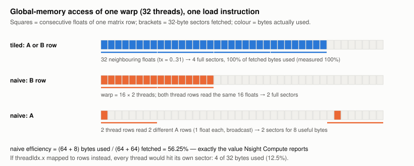
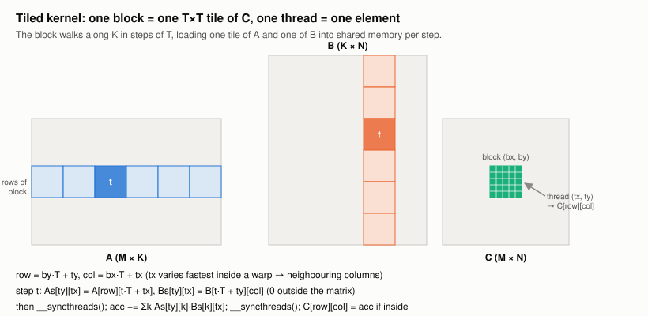
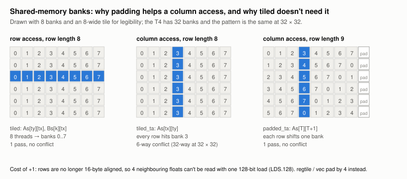
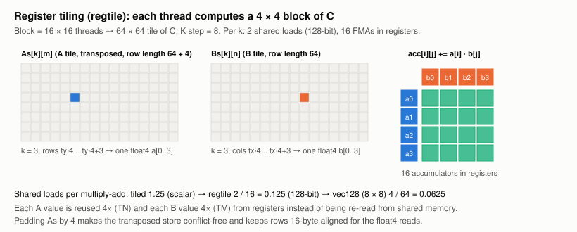
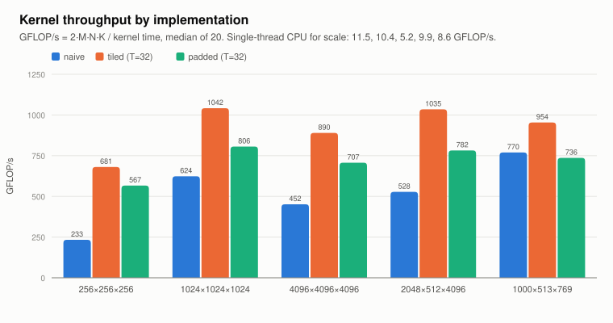
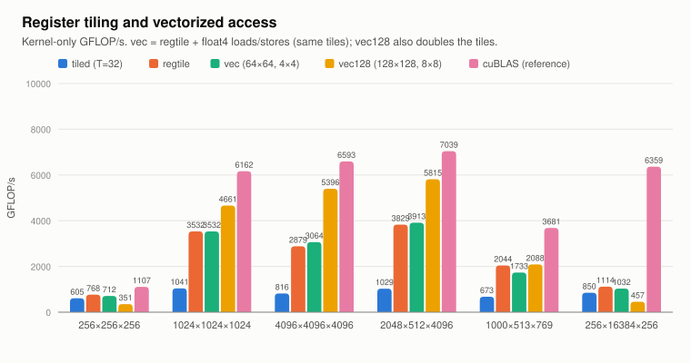
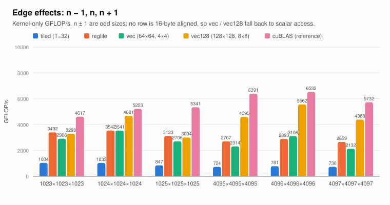

# Matrix Multiplication from CPU to Optimized CUDA: Final Report

**Course project, GPU Programming, IIT Madras · Tesla T4 · November 2026**

All numbers in this report come from one complete run of `scripts/reproduce.sh`, launched from a clean clone
with `notebooks/colab_reproduce.ipynb` on 13 Nov 2026. Raw data is in `results/`; the step-by-step optimization log is
[optimization_journey.md](optimization_journey.md).

---

## 1. Problem, environment and methodology

We compute **C = A·B** for row-major FP32 matrices A (M×K) and B (K×N), with any 1 ≤ M, N, K ≤ 16384.
There are four required implementations: single-threaded CPU, naive CUDA, shared-memory tiled CUDA, and
tiled with shared-memory padding. Three optional extensions add register tiling and vectorized access, and
**cuBLAS SGEMM** is used only as an external reference. Everything is one program:
`./matmul --impl {cpu,naive,tiled,padded,…} --input IN.bin --output OUT.bin [--tile 8|16|32]`.

| | |
|---|---|
| GPU | NVIDIA Tesla T4 (Turing, sm_75, 40 SMs), driver 580.82.07, max SM clock 1590 MHz, 70 W power limit |
| CPU | Intel Xeon @ 2.00 GHz, 2 vCPUs (Google Colab VM) |
| Toolchain | CUDA 13.0 (`nvcc` V13.0.88), host g++ |
| Flags | `nvcc -O3 -std=c++14 -arch=native -lcublas` (the repo now adds `-lineinfo`); `g++ -O2` for `compare` |
| Clocks | Not lockable on Colab: GPU boost clock and power management left at defaults. Nsight Compute locks the SM clock to base (585 MHz) while profiling, so profiled times are ~2.6× benchmark times |
| Inputs | `scripts/gen.py M K N 42`: values uniform in [−1, 1], fixed seed, binary format per spec |

**Timing.**
- **Kernel-only:** CUDA events around the launch.
- **End-to-end:** host `steady_clock` around `cudaMalloc` + host→device copies + kernel + device→host
  copy + `cudaFree`.
- **CPU:** `steady_clock` around the multiplication only.
- Each GPU figure is the **median of 20 trials after 3 warm-ups**. CPU: median of 3 (1 for the two
  largest shapes).
- Context and cuBLAS-handle creation happen before timing.
- GFLOP/s = 2·M·N·K / time.
- Commands: `bash scripts/bench.sh` with `SHAPE6="256 16384 256"`, `bash scripts/edge_sweep.sh`,
  `bash scripts/profile.sh`.

**Correctness criterion.** Every GPU output is compared element-wise with the CPU result:
`|out − ref| ≤ 1e-4·K + 1e-4·|ref|`, rejecting NaN and Inf. The CPU result is itself checked against a
float64 NumPy product. The tool reports max absolute error, max relative error and pass/fail
(`src/compare.cpp`).

---

## 2. Implementations

### 2.1 Single-threaded CPU: loop order i-k-j

```
for i in 0..M-1:  for k in 0..K-1:  a = A[i][k];  for j in 0..N-1:  C[i][j] += a * B[k][j]
```

The inner loop walks one row of B and one row of C with stride 1, and `A[i][k]` stays in a register.
Every fetched cache line is fully used and the loop vectorizes. The textbook i-j-k order would read B down
a column (stride N), using 4 bytes of each 64-byte line. One thread, no OpenMP or BLAS.
**5–8 GFLOP/s.** Performance falls at 4096³ because B (64 MiB) streams from DRAM for every row of C.

### 2.2 Naive CUDA: one thread per output element

```
block = (16, 16); grid = (ceil(N/16), ceil(M/16))
col = blockIdx.x*16 + threadIdx.x;  row = blockIdx.y*16 + threadIdx.y
if row < M and col < N:  C[row][col] = Σk A[row][k] * B[k][col]      # all operands from global memory
```

`threadIdx.x` maps to the **column**, so a warp reads neighbouring floats of a B row (coalesced) and writes
neighbouring C elements. Each output needs 2K global loads: every element of A is re-read N times, every
element of B M times.



A 16×16 block puts **two thread rows in one warp**. The B load is two full sectors, but the A load touches
two different rows: two sectors for 8 useful bytes. Predicted load efficiency is (64 + 8)/(64 + 64) =
**56.25%**, exactly what Nsight Compute measures.

### 2.3 Shared-memory tiled CUDA (`matmul_tiled<T, 0, false>`, T ∈ {8, 16, 32})



```
__shared__ float As[T][T], Bs[T][T]
row = by*T + ty;  col = bx*T + tx;  acc = 0
for t in 0 .. ceil(K/T)-1:
    As[ty][tx] = (row<M && t*T+tx<K) ? A[row][t*T+tx] : 0        # cooperative, coalesced, zero-filled
    Bs[ty][tx] = (t*T+ty<K && col<N) ? B[t*T+ty][col] : 0
    __syncthreads()                                              # tile complete before anyone reads it
    for k in 0..T-1:  acc += As[ty][k] * Bs[k][tx]               # each loaded value used by T threads
    __syncthreads()                                              # all reads done before it is overwritten
if row<M && col<N:  C[row][col] = acc                            # guarded store, no early return
```

- **Cooperative loading:** T×T threads each fetch one element of each tile, so global loads per output
  drop from 2K to 2K/T.
- **Two barriers:** the first prevents reading a half-loaded tile; the second prevents overwriting a tile
  that another warp is still reading.
- **Edges:** out-of-range elements are loaded as 0, which adds nothing to the dot product. Threads outside
  C still load and reach both barriers; only the store is guarded. So any M, N, K works.
- **Tile size:** T is a template parameter, so the inner loop unrolls. `check_tile_resources` rejects a T
  whose T² threads or 2T² floats don't fit the device, with a clear error and nonzero exit status.

**Access patterns.**
- Global: `tx` → column, so a warp reads 32 consecutive floats: **100% load efficiency** at 1024³.
- Shared: the stores `As[ty][tx]` and `Bs[ty][tx]` run along rows (32 different banks); `As[ty][k]` is
  the same word for a whole warp row (broadcast); `Bs[k][tx]` runs along a row.
- **There is no column-wise shared access, so no bank conflicts** (0 measured at every T).
- Because row length T is a multiple of 4, nvcc reads `As[ty][k..k+3]` with one 128-bit `LDS.U.128`
  (visible in the SASS).

### 2.4 Tiled with padding (`padded` = `matmul_tiled<T, 1, false>`)

Identical source with `__shared__ float As[T][T+1], Bs[T][T+1]`. The extra column is never touched;
only the physical row length changes, so padding is the only experimental variable.



Padding exists to fix **column** access. With row length 32, `tile[r][c]` is in bank c, so a warp walking
down a column hits one bank 32 times. With row length 33, bank = (r + c) mod 32, and a column spreads over
all 32 banks.

`tiled` never walks a column (2.3), so padding has nothing to fix. It also has two costs:
1. Rows of 33 floats aren't 16-byte aligned, so the `LDS.U.128` merge is impossible. Shared load
   instructions rise from **41.9 M to 67.1 M**.
2. At T = 8 and 16 a warp spans 2–4 thread rows. The odd row length wraps the next row onto an
   already-used bank, causing **2-way store conflicts**.

To show the mechanism working, two experiments store the A tile **transposed** (`As[tx][ty]`, a column
write):

| 1024³, T = 32 | tiled_ta (row 32) | padded_ta (row 33) |
|---|---|---|
| Store bank conflicts (Nsight) | **32,505,856** | **0** |
| Kernel time | 3.69 ms | 2.69 ms (**1.37× faster**) |

### 2.5 Extensions: register tiling and vectorized access



```
# regtile: 16×16 threads own a 64×64 C tile; each thread owns a 4×4 sub-block (acc[4][4] in registers)
for k0 in 0, 8, 16, ...:
    cooperative zero-filled load: A[64 rows][8] → As[k][m] (transposed, row 64+4); B[8][64 cols] → Bs[k][n]
    __syncthreads()
    for k in 0..7:  a = float4 As[k][ty*4..];  b = float4 Bs[k][tx*4..];  acc[i][j] += a[i]*b[j]  (16 FMAs)
    __syncthreads()
guarded stores of the 4×4 block
```

- **`regtile`:** each shared value is reused 4× from registers. That's 0.125 shared-load instructions per
  multiply-add instead of 1.25. A is stored transposed so a thread's four A values are contiguous; padding
  the row by **4** (not 1) makes that transposed store conflict-free and keeps rows aligned for `float4`.
- **`vec`:** regtile with the same tiles, plus 128-bit **global** loads (`LDG.E.128`), a 128-bit `STS` for
  B and 128-bit C stores. It isolates the effect of vectorization.
- **`vec128`:** 128×128 block tile, **8×8 outputs per thread**, `float4` everywhere. Adapted from a
  supplied kernel. Changes made:
  - bounds checks with zero fill;
  - `float4` only when K % 4 = 0 (A rows) or N % 4 = 0 (B, C rows) and all 4 elements are in range,
    scalar otherwise;
  - no read of the uninitialized output buffer (no β·C);
  - a padded transposed A tile (the original had a 2-way conflict);
  - each thread's 8 columns split into two groups of 4, BN/2 apart. Eight adjacent columns double the
    shared-memory passes per read.

---

## 3. Correctness

`scripts/run_tests.sh` checks every implementation and tile size on **18 shapes**:
- square, tall and wide;
- smaller than a block (5×3×7);
- divisible by 16 and 32;
- one below and above a tile multiple (15×17×16, 31³, 33³, 7×9×9);
- M, K or N = 1, and 1×1×1;
- **1000×513×769**;
- around the 64×64 regtile block (65×63×129);
- float4 alignment mixes (130×132×260, 129×64×130).

It also checks that a bad `--impl`, a missing input file and an unsupported `--tile` exit with a nonzero
status.

**Result: 327 / 327 checks pass** (`results/tests.txt`).
- Worst absolute error, for every GPU version, is **1.14 × 10⁻⁵** at 1000×513×769. That's ~4500× below
  the tolerance (≥ 0.051 at K = 513).
- The CPU matches float64 NumPy to 3.2 × 10⁻⁵.
- The worst *relative* error (9.6%) is on an element whose reference is almost zero. That's why the
  tolerance has an absolute term.
- All GPU versions report the same worst error. That's consistent with each summing along k in the same
  order with fused multiply-adds, while the CPU rounds separately.

---

## 4. Performance results

**Summary, 4096 × 4096 × 4096 (the largest required shape):**

| Kernel | Time (ms) | TFLOPS | Bandwidth (GB/s) | vs cuBLAS | Speedup over naive |
|---|---|---|---|---|---|
| CPU (single thread, i-k-j) | 25,850 | 0.005 | 0.01 | 0.1% | 0.013× |
| Naive (coalesced, 16×16) | 331.4 | 0.41 | 0.61 | 6.3% | 1.0× |
| Shared-memory tiled (T=32) | 168.4 | 0.82 | 1.20 | 12.4% | 2.0× |
| Tiled + padding (T=32) | 216.6 | 0.63 | 0.93 | 9.6% | 1.5× |
| 2D register tiling, 4×4 (regtile) | 47.74 | 2.88 | 4.22 | 43.7% | 6.9× |
| + Vectorized float4 (vec) | 44.85 | 3.06 | 4.49 | 46.5% | 7.4× |
| Vectorized, 8×8 per thread (vec128) | 25.47 | 5.40 | 7.90 | **81.8%** | **13.0×** |
| cuBLAS SGEMM (reference) | 20.85 | 6.59 | 9.66 | 100% | 15.9× |

TFLOPS = 2·M·N·K / kernel time. Bandwidth = (A + B + C bytes) / kernel time: the minimum data the
problem must touch ("effective" bandwidth), not measured DRAM traffic. vs cuBLAS = cuBLAS time / kernel
time. Kernel-only, median of 20; the T4's FP32 peak is 8.1 TFLOPS at boost clock.

All shapes, kernel-only time in ms with GFLOP/s in brackets:

| Shape | CPU | naive | tiled T=32 | padded T=32 | regtile | vec | vec128 | cuBLAS | best / cuBLAS |
|---|---|---|---|---|---|---|---|---|---|
| 256³ | 4.91 | 0.072 (467) | 0.055 (605) | 0.081 (417) | **0.044 (768)** | 0.047 (712) | 0.096 (351) | 0.030 (1107) | 69% |
| 1024³ | 294 | 7.05 (305) | 2.06 (1041) | 2.67 (804) | 0.608 (3532) | 0.608 (3532) | **0.461 (4661)** | 0.349 (6162) | 76% |
| 4096³ | 25 850 | 331 (415) | 168 (816) | 217 (634) | 47.7 (2879) | 44.9 (3064) | **25.5 (5396)** | 20.9 (6593) | 82% |
| 2048×512×4096 | 1661 | 18.1 (475) | 8.35 (1029) | 11.4 (755) | 2.24 (3829) | 2.20 (3913) | **1.48 (5815)** | 1.22 (7039) | 83% |
| 1000×513×769 | 106 | 1.02 (773) | 1.17 (673) | 1.48 (532) | 0.386 (2044) | 0.455 (1733) | **0.378 (2088)** | 0.214 (3681) | 57% |
| 256×16384×256 | 279 | 4.68 (459) | 2.53 (850) | 3.26 (659) | **1.93 (1114)** | 2.08 (1032) | 4.70 (457) | 0.338 (6359) | 18% |

| Speedup (kernel-only) | 256³ | 1024³ | 4096³ | 2048×512×4096 | 1000×513×769 | 256×16384×256 |
|---|---|---|---|---|---|---|
| naive vs CPU | 68× | 42× | 78× | 92× | 104× | 60× |
| tiled vs CPU | 89× | 143× | 153× | 199× | 90× | 110× |
| best GPU kernel vs CPU | 112× | 638× | 1015× | 1124× | 280× | 145× |
| naive → tiled | 1.30× | 3.42× | 1.97× | 2.17× | 0.87× | 1.85× |
| tiled → padded | 0.69× | 0.77× | 0.78× | 0.73× | 0.79× | 0.77× |
| tiled → regtile | 1.27× | 3.39× | 3.53× | 3.72× | 3.04× | 1.31× |

Values below 1 are slowdowns. Plots: [throughput by implementation](../results/plots/gflops_by_impl.svg),
[extensions](../results/plots/extensions.svg), [tile sizes](../results/plots/tile_sizes.svg),
[padding](../results/plots/padding_effect.svg), [gap to cuBLAS](../results/plots/percent_of_cublas.svg).




**Tile size (tiled kernel, ms):**

| | 256³ | 1024³ | 4096³ | 2048×512×4096 | 1000×513×769 |
|---|---|---|---|---|---|
| T = 8 | 0.070 | 3.61 | 369 | 18.8 | 1.81 |
| T = 16 | 0.056 | 2.31 | 226 | 9.27 | 1.20 |
| T = 32 | **0.055** | **2.06** | **168** | **8.35** | **1.17** |

- T = 32 wins everywhere, and is now the default `--tile`.
- T = 8 is slower than naive at 4096³ and 1000×513×769. It issues the same 41.9 M shared-load instructions
  as T = 32 but 4× the global requests and barriers, in 64-thread blocks.

**End-to-end** (ms, allocation + copies + kernel + copy back + free):

| | naive | tiled | regtile | vec128 | cuBLAS |
|---|---|---|---|---|---|
| 1024³ | 10.8 | 5.54 | 4.02 | 3.98 | 4.00 |
| 4096³ | 383 | 219 | 98.8 | 75.1 | 71.7 |

Once the kernel is fast, PCIe transfers and allocation dominate. At 1024³ regtile, vec128 and cuBLAS all
finish in 4.0 ms; vec128's kernel is only 12% of that. Kernel speedups only reach the user when data stays
on the GPU across many operations ([kernel share plot](../results/plots/kernel_share_e2e.svg)).

---

## 5. Profiler evidence and the optimization log

Nsight Compute, 1024³, profiled at base clock. `results/profile_summary.csv`; every rule message is in
`results/profile/rules_summary.md`.

| | naive | tiled T=8 | tiled T=32 | padded T=32 | regtile | vec | vec128 | cuBLAS |
|---|---|---|---|---|---|---|---|---|
| Time (ms, ncu) | 8.97 | 9.10 | 5.31 | 6.94 | 1.59 | 1.60 | 1.18 | 0.82 |
| Global load requests | 67.1 M | 8.39 M | 2.10 M | 2.10 M | 1.05 M | 0.26 M | 0.13 M | 0.92 M |
| Global load efficiency | 56% | 100% | 100% | 100% | 100% | 100% | 100% | 81% |
| DRAM read | 213 MB | 169 MB | 146 MB | 139 MB | 34 MB | 28 MB | 17 MB | 37 MB |
| Shared load instructions | – | 41.9 M | 41.9 M | 67.1 M | 4.19 M | 4.19 M | 2.10 M | 2.36 M |
| Shared wavefronts (ld + st) | – | 58.7 M | 52.4 M | 69.2 M | 13.6 M | 13.6 M | 6.8 M | 5.8 M |
| Bank conflicts (ld / st) | – | 0 / 0 | 0 / 0 | 0 / 0 | 0 / 0 | 0 / 0 | 0 / 0 | 39 K / 257 K |
| Achieved occupancy | 99% | 99% | 100% | 100% | 84% | 84% | 36% | 47% |
| Registers / thread | 50 | 38 | 44 | – | 64 | 54 | 123 | 122 |
| SM throughput | 64% | 55% | 74% | 88% | 48% | 46% | 62% | 89% |
| Main limiter (Nsight) | LG queue (global) | MIO + launch | **MIO (shared)** | MIO (shared) | latency + 1.6-wave tail | same | FMA 62%, 0.8 wave | **FMA 89%** |

**Optimization 1: naive → tiled.**
- *Observation:* naive issues 67 M global load requests at 56% efficiency. Warps stall 28.9 of 35.6
  cycles waiting for the global-memory (LG) queue.
- *Change:* shared-memory tiling.
- *Effect:* requests fall **exactly T×** (8.39 / 4.19 / 2.10 M for T = 8 / 16 / 32), and efficiency
  reaches 100%.
- *But DRAM traffic falls only 1.1–1.5×.* Naive's 4.3 GB of L1 requests were already mostly served by L2
  (213 MB reached DRAM), so the speedup is 1.7× under the profiler, not 32×.
- *New limiter:* for T = 32, warps stall **24.0 of 36.9 cycles (65%) on the MIO (shared-memory) queue**.
  Across every tiled and padded variant at T = 16/32, kernel time is almost exactly proportional to
  shared-memory wavefronts, about 100 ns per million
  ([plot](../results/plots/time_vs_wavefronts.svg)).

**Optimization 2: padding (required; unsuccessful here).**
- *Prediction:* `scripts/bank_model.py` predicted the bank-conflict count of every variant, and **Nsight
  matched it exactly**: 0 for tiled, 4,194,304 store conflicts for padded T = 16, 32,505,856 for tiled_ta
  T = 32, and so on.
- *Result:* `padded` is 21–31% slower than `tiled`. It has 1.6× more shared instructions (lost
  `LDS.128`) and 1.32× more wavefronts, and time follows wavefronts.
- *Where it does help:* padding works as designed where a column access exists (tiled_ta → padded_ta,
  §2.4).

**Optimization 3: register tiling (profiler-guided).**
- *Reasoning:* the shared pipe was the limiter, so do more work per shared load.
- *Effect:* shared instructions fall 10× and wavefronts 3.9×, with 0 conflicts. The kernel is
  **3.0–3.7× faster** on the large shapes (prediction: 1.5–3×).
- *New limiters (Nsight):*
  - latency: SM and memory throughput both below 50%, with MIO stalls down to 44%;
  - a **1.6-wave tail**: 256 blocks for 160 resident slots, estimated up to 50% loss;
  - uncoalesced C stores (8 of 32 bytes per sector).

**Optimization 4: vectorized access (`vec`).**
- *Effect on memory:* 4× fewer global load requests, fully coalesced stores (the 8/32-byte warning
  disappears).
- *Effect on time: 1.00×.* The SASS shows nvcc had already used `LDS.U.128` in regtile, and regtile wasn't
  global-memory bound (DRAM 7.8% busy, L2 hit 86%). It optimized a non-bottleneck.

**Optimization 5: bigger per-thread tile (`vec128`, 8×8).**
- *Effect:* 64 independent accumulators cut warp cycles per instruction from 17.9 to **6.6**, and the FMA
  pipe becomes the busiest unit (62%). It's **1.3–1.8× faster than vec** on large shapes.
- *Cost:* 123 registers per thread limit occupancy to 50% (36% achieved), and at 1024³ only 64 blocks
  launch: 0.8 of a wave on 40 SMs.

---

## 6. Edge effects and the instructor-approved shape



`scripts/edge_sweep.sh` times n − 1, n and n + 1 for n = 1024 and 4096. These are multiples of every tile
and of the 64/128 blocks.

- **Tiled kernels lose up to 18% at n + 1.** 1025 needs 33² instead of 32² blocks and 33 K-steps for 0.3%
  more work, and the extra row and column of blocks is almost entirely zero-filled.
- **regtile loses at most 12%.**
- **vec and vec128 lose 17–36% at both n − 1 and n + 1.** n ± 1 is odd, so no row is 16-byte aligned and
  every access falls back to scalar loads. The fallback is also uncoalesced: in a single load instruction
  the 32 threads of a warp touch 16 different rows. At 1000×513×769 Nsight measures **6.2 of 32 bytes used
  per sector and 80% excessive sectors**, versus 19.3 bytes and 41% for regtile. That makes vec *slower*
  than regtile on odd shapes (0.85×).
- **cuBLAS varies only ±12%.**
- Naive alone is 36% slower at exactly 1024 than at 1023, and its 1024³ time varied across runs (3.4–7.1 ms).
  A power-of-two row stride aliasing in the memory system is a plausible but **unverified** explanation.

**6th shape, 256×16384×256** (hypothesis: *too little parallelism*): confirmed.

| | blocks | 1024³ | 256×16384×256 |
|---|---|---|---|
| tiled T=32 | 64 | 1041 GFLOP/s | 850 (−18%) |
| regtile | 16 | 3532 | 1114 (−68%) |
| vec128 | 4 | 4661 | 457 (**−90%**) |
| cuBLAS | – | 6162 | 6359 (+3%) |

With 4–16 blocks, most of the 40 SMs idle for the whole kernel, so the best square-shape kernel becomes the
worst. cuBLAS is unaffected, most likely by splitting the K dimension across more blocks (not profiled at
this shape).

---

## 7. Remaining gap to cuBLAS

cuBLAS (`volta_sgemm_128x64_nn`, 122 registers, 50% theoretical occupancy, the same as vec128) reaches 6.2–7.0
TFLOP/s on the large shapes, up to 86% of the T4's 8.1 TFLOP/s FP32 peak at boost clock. Its FMA pipe is 89% busy. Our best
kernel reaches 76–83% of cuBLAS on large aligned shapes, 57% on 1000×513×769 and 18% on the skinny shape.
The profiles point to three causes:

1. **Work distribution.** cuBLAS launches 640 blocks of 128 threads at 1024³ (4 waves); vec128 launches 64
   (0.8 wave), with a 26% spread in SM active cycles.
2. **Issue efficiency.** At equal occupancy cuBLAS issues 2.20 instructions per cycle against 1.77, and more
   of them are FMAs. Ours spend issue slots on address arithmetic, bounds checks and two barriers per K
   step, with no double buffering to overlap the next tile's load with computation.
3. **Odd shapes and small grids.** We have no aligned path for odd K or N, and no split-K for skinny
   problems.

**Future work, by expected payoff:**
- split-K, or a smaller tile when the grid is small;
- double-buffered shared memory;
- a coalesced scalar fallback, or padding A and B to multiples of 4 on the device;
- separate interior and edge kernels, to drop bounds checks from the interior.

---

## 8. Unsuccessful experiments and lessons

| Experiment | Expected | Measured | Lesson |
|---|---|---|---|
| Padding the tiled kernel (`padded`) | fewer bank conflicts | 21–31% slower; conflicts 0 → 4.2 M at T = 16; 128-bit loads lost | Profile for conflicts *before* padding. Padding fixes column access only, and an odd pad can break vector alignment (pad by 4 when using `float4`) |
| Tile size 8 | more blocks → better occupancy | slower than naive on 2 shapes | Occupancy was already ~99% for every T; per-step overhead and request count dominate |
| `float4` access alone (`vec`) | 1.0–1.3× | 1.00× aligned, **0.85×** on odd shapes | Optimize the measured bottleneck. Vector paths need an aligned *and* coalesced fallback |
| Large 8×8 tile everywhere (`vec128`) | fastest | fastest on large shapes, **2× slower** on 256³ and 256×16384×256 | The best tile depends on shape. Small grids need small tiles or split-K |
| Comparing runs from different Colab sessions | same numbers | up to 2× differences for some kernels | Report one run. Medians remove noise within a run, not between VMs |

**What I would keep.**
- Predict first, then measure. The bank model and the load-count arithmetic matched Nsight exactly, so
  every discrepancy pointed at something real (L2 absorbing naive's reuse, the hidden `LDS.128`).
- Change one variable at a time: `tiled`/`padded` and `regtile`/`vec` share code and differ only in
  padding or vectorization.

---

## 9. Reproducing the results

```
git clone https://github.com/shriramiitm/nvidia-mm.git && cd nvidia-mm
ARCH=sm_75 SHAPE6="256 16384 256" bash scripts/reproduce.sh      # build, tests, bench, sweep, profile, tables, plots
```

On Google Colab, run `notebooks/colab_reproduce.ipynb`. It clones a clean copy, writes results to Google
Drive while they're produced, and downloads a zip. Profiler commands are in `scripts/profile.sh`:
`ncu --set full` plus a metric CSV per kernel and a details-page text export. Rule messages:
`python3 scripts/extract_rules.py results/profile`. Diagrams: `python3 scripts/make_figures.py`.
